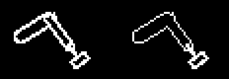

# Second Dimension

Second Dimension is an Arduino and PlatformIO library for 32-bit boards that draws
1-bit pixel-art sprites at any angle, turned about a pivot pixel, and poses them as
rigs of bones, with two-bone inverse kinematics to aim a limb. It draws into a 1-bit
buffer or any Adafruit GFX display, and never allocates.

See it running at https://dangelo.engineering (Daedalus there is posed and drawn with it).



## Install

- **Arduino IDE:** download this repository as a ZIP (Code > Download ZIP), then
  Sketch > Include Library > Add .ZIP Library.
- **PlatformIO:** `lib_deps = https://github.com/dangelo729/second_dimension.git`

It needs a 32-bit board and a C++14 compiler; AVR is refused. `SecondDimension.h`
needs no other library. `SecondDimension_GFX.h`, for an Adafruit GFX display, needs
the Adafruit GFX Library, and the examples also need Adafruit SSD1306.

## Use

The code of [`examples/01_Arm`](examples/01_Arm/01_Arm.ino), then the main calls:

```cpp
#include <Adafruit_SSD1306.h>
#include <SecondDimension_GFX.h>
#include "arm_art.h"  // upper_arm, forearm, mallet

Adafruit_SSD1306 display(128, 64, &Wire, -1);
SD_GFXTarget target(display);

SD_Bone bones[] = {
  // parent  ox     oy     angle  flipX  visible  sprite
  {-1,       30.0f, 32.0f, 0.0f,  false, true,    &upper_arm},  // shoulder, on the panel
  {0,        17.0f, 0.0f,  0.0f,  false, true,    &forearm},    // elbow, on the upper arm
  {1,        16.0f, 0.0f,  0.0f,  false, true,    &mallet},     // hand, on the forearm
};
SD_Xform world[3];
SD_Rig arm(bones, world, 3);

void setup() { display.begin(SSD1306_SWITCHCAPVCC, 0x3C); }

void loop() {
  float t = millis() * 0.001f;  // the mallet head, 10 px past the hand, goes round a circle
  float tx = 60.0f + 12.0f * cosf(t) - bones[0].ox;  // in the shoulder's frame
  float ty = 32.0f + 12.0f * sinf(t) - bones[0].oy;
  sd_ik2(17.0f, 16.0f + 10.0f, tx, ty, 1.0f, bones[0].angle, bones[1].angle);
  arm.pose();
  display.clearDisplay();
  arm.draw(target);
  display.display();
}
```

- **Sprite:** `SD_Sprite`, a 1-bit image (ink and mask) with a pivot pixel.
- **Transform:** `sd_draw(target, sprite, SD_Xform::rigid(x, y, angle, flipX))` draws
  a sprite with its pivot on `(x, y)`; `SD_Xform::scaled(..., scale)` also scales it.
- **Rig:** `SD_Bone`s in a table, parents first, each child pinned to its parent's
  sprite; an `SD_Rig`'s `pose()` places them and its `draw(target)` draws them in order.
- **IK:** `sd_ik2(l1, l2, tx, ty, bendSign, a1, a2)` sets the angles that put a two-bone
  chain's tip on a point, and returns whether it reached.
- **Group:** `sd_drawGroup(target, rig, bones, list, n, shape, ink)` draws the listed
  bones as one shape with one outline; mark them invisible so `draw()` skips them.
- **Canvas:** `SD_Canvas(buffer, w, h)`, a 1-bit framebuffer in `drawBitmap`'s layout.
- **Target:** `SD_GFXTarget(display)` for any Adafruit GFX display, or a subclass of
  `SD_Target` (`width()`, `height()`, `plot(x, y, on)`) for anything else.

Angles are radians, clockwise on the panel; x runs right and y down.

## Your own art

Draw each sprite on a transparent background (light pixels draw white, dark ones
black), mark the pixel it turns about in `#ff00ff`, and run
`python3 tools/png2sprite.py arm.png forearm.png -o arm_art.h` (Python 3.9 or later)
to write their header. [The asset pipeline](extras/docs/asset-pipeline.md) has more.

## Examples

- [`01_Arm`](examples/01_Arm/01_Arm.ino): an arm of three sprites as a rig, aimed by IK.
- [`02_Group`](examples/02_Group/02_Group.ino): the same arm, its two segments one shape.

## Tests

```sh
make -C test/host run
```

## More

[Conventions](extras/docs/conventions.md), [the asset pipeline](extras/docs/asset-pipeline.md),
[memory and cost](extras/docs/memory.md), [testing](extras/docs/testing.md) and
[the changelog](CHANGELOG.md).

## License

MIT, see [LICENSE](LICENSE). No Adafruit code is copied; the sprite planes share
Adafruit GFX's `drawBitmap` row layout.
